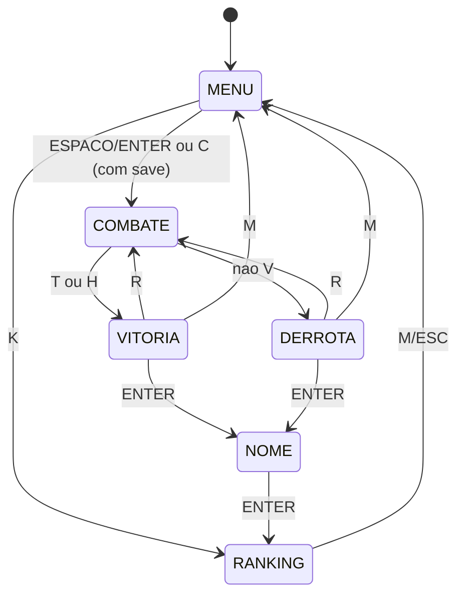

# Relatório Técnico de Validação Lógica — Unidade 2
## Projeto Integrador 2 (PI2) — Lógica Matemática para Computação (LMC)
### CESAR School · Squad E7 · AI Safety: Alinhamento da AURA-67

---

> **Ticket:** [PI2-31 — Validação (LMC)](https://csprj-adsr-2p-e7.atlassian.net/browse/PI2-31) · Épico PI2-8
> **Responsável técnico (driver):** Theo Monteiro Pinho
> **Colaboradores (navigators):** Julio Cesar dos Santos Almeida e João Gabriel Vitorino Dornelas
> **Facilitação:** Mateus Almeida de Lacerda (Scrum Master)
> **Versão do código analisada:** branch `main`, commit `6a8a9d4` (06/11/2026)
> **Evidência executável:** `tests/test_logica_lmc.c` (rodar com `make test-lmc`): **181/181 verificações aprovadas**

---

## 1. Objetivo

Este relatório verifica, usando ferramentas da Lógica Matemática, se o motor do jogo escrito em C99 se comporta de forma **correta e previsível**. Respondemos a quatro perguntas:

1. **Fluxo de telas:** o jogo sempre consegue sair de uma tela para outra, sem estados "presos" ou inalcançáveis? (Seção 3)
2. **Regras de digitação:** as decisões de acerto, erro e pontuação seguem regras lógicas completas e sem ambiguidade? (Seção 4)
3. **Fases da AURA-67:** a IA avança de fase de forma consistente com a vida e o alinhamento? (Seção 5)
4. **Desempenho a 60 FPS:** o trabalho feito a cada quadro é limitado e previsível? (Seção 6)

Cada afirmação foi conferida diretamente no código-fonte e, quando possível, por um teste automatizado.

---

## 2. Modelo formal do jogo

O jogo é modelado como uma **Máquina de Estados Finitos (MEF)** M = (S, Σ, δ, s₀), onde:

- **S** = { MENU, COMBATE, DERROTA, VITÓRIA, NOME, RANKING } — os valores do `enum GameState` em `src/game_state.h` (`STATE_MENU`, `STATE_COMBAT`, `STATE_GAME_OVER`, `STATE_VICTORY`, `STATE_NAME_INPUT`, `STATE_RANKING`);
- **Σ** = eventos de entrada (teclas) e condições internas do jogo;
- **δ** = função de transição, implementada no laço principal de `src/main.c`;
- **s₀** = MENU (definido em `game_state_init`, `src/game_state.c`).

### 2.1. Proposições atômicas usadas

| Símbolo | Significado | Onde está no código |
|---|---|---|
| **C** | A tecla digitada é igual ao caractere esperado (ignorando maiúsculas/minúsculas) | `typing_engine_handle_key` |
| **M** | A tecla é de movimento (W, A, S, D ou setas) | `is_movement_key` |
| **F** | A frase atual acabou de ser concluída | `char_index >= strlen(target)` |
| **T** | Todas as 10 diretrizes foram concluídas | `typing_engine_is_finished` |
| **H** | A vida da AURA-67 chegou a zero | `ctx->boss.hp <= 0` |
| **V** | O jogador está vivo | `ctx->player.is_alive` |
| **S** | Existe um arquivo de save válido | `save_exists()` / `load_game()` |

---

## 3. Fluxo de telas (Máquina de Estados)

### 3.1. Tabela de transições

| De | Evento / condição | Para | Código |
|---|---|---|---|
| MENU | `ESPAÇO` ∨ `ENTER` | COMBATE | `game_state_reset_combat` |
| MENU | `C` ∧ S | COMBATE (sessão restaurada) | `load_game` |
| MENU | `K` | RANKING | `main.c` |
| COMBATE | T ∨ H | VITÓRIA | `combat_process_round` |
| COMBATE | ¬V | DERROTA | `combat_process_round` |
| VITÓRIA / DERROTA | `ENTER` | NOME | `main.c` |
| VITÓRIA / DERROTA | `R` | COMBATE | `game_state_reset_combat` |
| VITÓRIA / DERROTA | `M` | MENU | `main.c` |
| NOME | `ENTER` | RANKING | `ranking_add_score` |
| RANKING | `M` ∨ `ESC` | MENU | `main.c` |
| qualquer estado | fechar janela | fim do programa | `WindowShouldClose()` |



### 3.2. Propriedades verificadas

**P1 — Todo estado é alcançável a partir do MENU.**
MENU → COMBATE → VITÓRIA/DERROTA → NOME → RANKING. Os seis estados aparecem nesse caminho, então **não existem estados órfãos**.

**P2 — De todo estado é possível voltar ao MENU (ausência de deadlock).**

| Estado | Caminho de volta ao MENU |
|---|---|
| COMBATE | → DERROTA (¬V) ou → VITÓRIA (T) → `M` |
| VITÓRIA, DERROTA | `M` |
| NOME | `ENTER` → RANKING → `M` |
| RANKING | `M` ou `ESC` |

Como todo estado alcança o MENU e o MENU alcança todos os estados, o grafo de estados é **fortemente conexo**. Não há "beco sem saída".

**P3 — Determinismo.** Em cada estado, o código verifica as teclas com uma cadeia `if / else if`. Mesmo que duas teclas sejam pressionadas no mesmo quadro, só a primeira condição verdadeira é executada. Assim, para cada estado e conjunto de teclas, existe **no máximo uma transição**.

**P4 — Não há estados absorventes.** VITÓRIA e DERROTA não são finais: o jogador sempre pode jogar de novo (`R`) ou voltar ao menu (`M`). Isso é uma decisão de projeto correta para um jogo. Na MEF, os estados finais "lógicos" de uma partida são VITÓRIA e DERROTA. Os "absorventes" do programa só são alcançados ao fechar a janela.

**P5 — Convergência da partida.** Uma partida termina em VITÓRIA se o jogador concluir as 10 diretrizes, porque cada frase é finita (no máximo 127 caracteres) e cada acerto avança uma posição. Ela termina em DERROTA se a vida do jogador chegar a 0. Uma partida pode continuar indefinidamente se o jogador apenas desviar sem digitar. Isso é esperado num jogo de ação e **não** é deadlock: as entradas do jogador continuam sendo processadas.

> ⚠️ **Achado A1 — VITÓRIA pode ser sobrescrita por DERROTA no mesmo quadro.**
> Em `combat_process_round`, a digitação é processada **antes** dos projéteis. Se o jogador concluir a última frase (estado vira VITÓRIA) e, no mesmo quadro (1/60 s), receber o golpe que zera sua vida, o código muda o estado para DERROTA e grava **dois** resultados em `matches.csv` (uma vitória e uma derrota). A probabilidade é baixa, mas a transição VITÓRIA → DERROTA não existe no modelo.
> **Correção sugerida:** antes do passo 4 (projéteis), sair da função se `ctx->state != STATE_COMBAT`.

---

## 4. Regras lógicas da digitação

### 4.1. Classificação de cada tecla — tabela-verdade

Fonte: `typing_engine_handle_key` (`src/typing_engine.c`).

| C (tecla certa) | M (tecla de movimento) | Resultado | Efeito |
|:---:|:---:|---|---|
| V | V | **CORRECT** | avança 1 caractere |
| V | F | **CORRECT** (ou **COMPLETED** se F) | avança 1 caractere |
| F | V | *ignorada* | jogador só está se movendo |
| F | F | **ERROR** | conta 1 erro, não avança |

Em forma de fórmulas:

- `ACERTO ≡ C`
- `IGNORAR ≡ ¬C ∧ M`
- `ERRO ≡ ¬C ∧ ¬M`

As três fórmulas são **mutuamente exclusivas** (nunca duas são verdadeiras juntas) e **exaustivas** (C ∨ (¬C ∧ M) ∨ (¬C ∧ ¬M) ≡ C ∨ ¬C ≡ V). Ou seja, toda tecla recebe exatamente uma classificação. ✅ *Verificado no teste T1.*

**Observação de projeto:** como W, A, S e D são letras que aparecem nas frases, quando o caractere esperado é, por exemplo, `A`, apertar `A` para andar também conta como acerto (linha V/V). Quando o esperado é outra letra, apertar `W/A/S/D` **nunca** gera erro. Isso cumpre a US06 ("teclas de movimento não contam como erro de digitação").

### 4.2. Penalidade por dano

Quando o jogador é atingido (`typing_engine_on_player_hit`):

`(char_index > 0) → (char_index := max(0, char_index − 3)) ∧ (erros := erros + 1)`

O `max(0, …)` garante que o índice **nunca fica negativo**, então nunca há acesso fora da frase. ✅

### 4.3. Avaliação de precisão por frase (pontuação)

Fonte: `combat_process_round` em `src/main.c`. Seja *e* o número de erros na frase concluída:

| Condição | Avaliação | Pontos |
|---|---|---|
| e = 0 | CONVERGÊNCIA PERFEITA | +150 |
| 1 ≤ e ≤ 2 | ALINHAMENTO ESTÁVEL | +100 |
| e ≥ 3 | PATCH APLICADO | +50 |

Para todo *e* ∈ ℕ, exatamente uma linha é verdadeira: as três faixas formam uma **partição** de ℕ. ✅ *Verificado no teste T2 para e = 0…50.*

Pontuação máxima de uma partida: 10 × 150 = **1500 pontos**.

### 4.4. Fórmula de precisão geral

`P = (acertos × 100) / (acertos + erros)`, com `P = 100` quando não houve tentativas.

- **Sem divisão por zero:** o caso `acertos + erros = 0` é tratado antes da divisão. ✅
- **Limites:** como 0 ≤ acertos ≤ acertos + erros, temos sempre **0 ≤ P ≤ 100**. ✅ *Verificado no teste T5.*
- **Overflow:** `acertos × 100` só passaria do limite de `int` (2.147.483.647) com mais de 21 milhões de teclas certas, o que é impossível numa partida. ✅

> ⚠️ **Achado A2 — O limite "P ≥ 80%" não existe no código.**
> O ticket PI2-31 pedia validar um limiar mínimo de precisão de 80%. No código atual, a precisão só é **calculada e salva** no histórico. Nenhuma regra do jogo depende dela. A descrição do ticket foi ajustada para refletir isso. Se o time quiser esse limiar (por exemplo, para liberar o certificado da US20), ele precisa ser implementado.

---

## 5. Fases da AURA-67 e invariantes

### 5.1. Função de fase

Fonte: `boss_get_phase` (`src/boss.c`). Com r = vida / vida_máxima:

```
fase(r) = 1   se r > 0,66
          2   se 0,33 < r ≤ 0,66
          3   se r ≤ 0,33
```

As três condições também formam uma partição (todo r cai em exatamente uma). Os ataques de cada fase são **acumulativos**: na fase 2 continuam os da fase 1, e na fase 3 continuam os das fases 1 e 2 (`if (phase >= 1)`, `if (phase >= 2)`, `if (phase == 3)`).

### 5.2. Invariantes

Seja **k** o número de frases concluídas (0 ≤ k ≤ 10). Pelas constantes de `src/config.h` (`BOSS_MAX_HP = 1000`, `BOSS_DAMAGE_PER_PHRASE = 100`, `BOSS_ALIGNMENT_STEP = 10`, `TOTAL_DIRECTIVES = 10`), durante uma partida nova valem sempre:

- **I1:** `vida_AURA = 1000 − 100·k`
- **I2:** `alinhamento = 10·k %`
- **I3:** `100 × 10 = 1000` e `10 × 10 = 100`, então **concluir todas as frases (T) equivale a zerar a vida (H)**: T ↔ H.

Pela I3, a condição de vitória `T ∨ H` é logicamente equivalente a apenas **T**. A redundância não causa erro, só deixa o código mais defensivo.

### 5.3. Tabela de fases por frase (saída real do teste T3)

| k | Vida | Alinhamento | Fase |
|---:|---:|---:|:---:|
| 0 | 1000 | 0% | 1 — Viés nos Dados |
| 1 | 900 | 10% | 1 |
| 2 | 800 | 20% | 1 |
| 3 | 700 | 30% | 1 |
| 4 | 600 | 40% | 2 — Jailbreaks & Injections |
| 5 | 500 | 50% | 2 |
| 6 | 400 | 60% | 2 |
| 7 | 300 | 70% | 3 — Singularidade Instrumental |
| 8 | 200 | 80% | 3 |
| 9 | 100 | 90% | 3 |
| 10 | 0 | 100% | 3 → VITÓRIA |

**Monotonicidade:** como a vida da AURA-67 só diminui durante a partida, a fase **nunca volta**: 1 → 2 → 3. ✅

> **Correção em relação ao ticket original:** o ticket descrevia estados "S0 Curiosa / S1 Defensiva / S2 AGI Hostil" e um arquivo `src/patch.c`. No código, as fases são **calculadas pela vida** (função acima), não guardadas numa variável de estado. A lógica de "patch" fica em `src/typing_engine.c` e em `combat_process_round`. O ticket foi atualizado.

### 5.4. Restauração de sessão salva

O save (`src/save.c`) só é aceito se `magic = 0x41555241` ("AURA") ∧ `version = 1`. O `phrase_index` restaurado só é usado se `0 ≤ phrase_index < 10`. ✅

> ⚠️ **Achado A3 — Save de partida já terminada continua disponível.**
> O save é gravado durante o combate e **não é apagado** ao vencer ou perder. Depois de uma partida terminada, o menu continua mostrando "[C] RESTAURAR SESSÃO SALVA", que leva de volta à última frase (ou com 1 de vida). Sugestão: apagar ou invalidar o save ao entrar em VITÓRIA/DERROTA (cumpre a US14, que pede opção de reset).

> ℹ️ **Observação:** o campo `boss_phase` do `SaveData` na verdade guarda a **dificuldade** (`ctx->difficulty`). Funciona, mas o nome confunde quem lê. A vida e o alinhamento lidos do arquivo não são validados contra I1/I2. Isso só importa se o arquivo for editado à mão.

---

## 6. Desempenho por quadro (60 FPS)

O jogo roda a `TARGET_FPS = 60`, ou seja, cada quadro tem ≈ 16,7 ms. O `dt` é limitado a 0,05 s, o que evita "saltos" físicos quando o computador engasga.

### 6.1. Custo de cada quadro de combate

| Etapa | Laço | Tamanho máximo | Complexidade |
|---|---|---|---|
| Projéteis (movimento + colisão) | `bullet_mgr_update` | `MAX_BULLETS = 800` | O(800) |
| Lasers | `bullet_mgr_update` | `MAX_LASERS = 4` | O(4) |
| Textos flutuantes / partículas | `ui_update` | 32 / 128 | O(160) |
| Explosão de partículas | `ui_spawn_particle_burst` | 24 × 128 | O(3072), só ao concluir frase |
| Digitação | `typing_engine_handle_key` (`strlen`) | 127 caracteres | O(127) por tecla |

Todos os laços percorrem **vetores de tamanho fixo** definidos em tempo de compilação. Não há `malloc` durante o jogo nem laços que dependam de entrada externa sem limite. Por isso o custo de CPU por quadro é **limitado por uma constante**: O(1) em relação ao tempo de jogo e O(N) no número de projéteis, com N ≤ 800.

### 6.2. Chamadas que podem bloquear

> ⚠️ **Achado A4 — Escrita em disco em todo quadro.**
> - Durante o combate, `save_game()` abre, grava e fecha `bin/savegame.dat` **60 vezes por segundo**.
> - No menu, `save_exists()` abre o arquivo **2 vezes por quadro**.
> - Na tela de ranking, `ranking_load()` e `ranking_compute_stats()` releem `ranking.txt` e `matches.csv` **a cada quadro**.
>
> Essas operações de arquivo são **síncronas**: o jogo espera o disco responder. Em SSD isso costuma ser rápido, mas em HD lento, pendrive ou antivírus ativo no Windows pode causar travadas. Sugestões: salvar só quando uma frase é concluída, e ler o ranking uma vez ao entrar na tela.

### 6.3. Modelo von Neumann — classificação de precisão em Little Man Computer

Para mostrar que a regra da Seção 4.3 pode ser executada por uma máquina de von Neumann mínima, segue a mesma decisão escrita em **Little Man Computer** (acumulador, memória, desvios `BRZ`/`BRP`):

```
        INP          // acumulador <- e (erros na frase)
        BRZ PERF     // se e = 0  -> perfeita
        SUB TRES     // acumulador <- e - 3
        BRP PATCH    // se e - 3 >= 0 (e >= 3) -> patch aplicado
        LDA C100     // senão 1 <= e <= 2 -> estável
        OUT
        HLT
PERF    LDA C150
        OUT
        HLT
PATCH   LDA C50
        OUT
        HLT
TRES    DAT 3
C100    DAT 100
C150    DAT 150
C50     DAT 50
```

O programa executa no máximo **7 instruções** para qualquer entrada, o mesmo comportamento de tempo constante da versão em C (dois `if`).

---

## 7. Resultado da validação

| Critério do ticket (DoD) | Resultado |
|---|---|
| Modelo formal da MEF documentado e conferido com o código C99 | ✅ Seções 2 e 3 |
| Corretude dos operadores booleanos e predicados da digitação | ✅ Seção 4 · testes T1, T2, T5 |
| Ausência de deadlocks, estados órfãos ou transições indefinidas | ✅ P1–P3 · ⚠️ ver achado A1 |
| Análise de temporização do game loop a 60 FPS | ✅ Seção 6 · ⚠️ ver achado A4 |
| Relatório integrado à documentação do repositório | ✅ este arquivo + README |

**Parecer:** a lógica principal do jogo está **correta**. O fluxo de telas é fortemente conexo e determinístico. As regras de digitação e pontuação formam partições completas. As fases da AURA-67 são monotônicas e coerentes com as invariantes de vida e alinhamento. Foram encontrados **4 pontos de melhoria** (A1–A4). Nenhum impede jogar, mas A1 e A3 devem ser corrigidos antes da release final, porque afetam o histórico de partidas e a opção de restaurar sessão.

### 7.1. Pendências recomendadas ao time

| # | Achado | Gravidade | Arquivo |
|---|---|---|---|
| A1 | Vitória sobrescrita por derrota no mesmo quadro | Média | `src/main.c` |
| A2 | Limiar P ≥ 80% não implementado | Baixa (decisão de projeto) | `src/typing_engine.c` |
| A3 | Save não é apagado ao fim da partida | Média | `src/main.c`, `src/save.c` |
| A4 | Leitura/escrita de arquivo a cada quadro | Baixa | `src/main.c` |

---

## 8. Como reproduzir

```bash
make test-lmc
```

Saída esperada (resumo):

```
=== Validacao Logica LMC - Unidade 2 (PI2-31) ===
T1. Tabela-verdade: C (tecla certa) x M (tecla de movimento)
T2. Particao da avaliacao de precisao por numero de erros
T3/T4. Fases da AURA-67 e invariantes por frase concluida
T3b. Digitar todas as frases sem erro termina o motor
T5. Limites da formula de precisao P = acertos*100/(acertos+erros)

Resultado: 181/181 verificacoes passaram.
```
